# circuitCad

**English | [日本語](README.md)**

**Draw a schematic, simulate it, turn it into a PCB, and export manufacturing files, all in one free app built for people learning electronics.**

circuitCad combines schematic capture, SPICE-style simulation, PCB layout and Gerber export in a single desktop application. It is aimed at beginners who want to go from "learning a circuit" to "experimenting with it" to "ordering a real board" without switching tools.

> **English UI.** The whole interface (menus, hover help, error messages, the operation guide, the glossary, the learning paths and all lessons) can be shown in English: **Settings → Language / 言語 → English**, or start it with `--lang en`. The English text was translated with AI help from the Japanese original; if a sentence reads oddly, please open an issue (or fix the line in [`crates/i18n/en/`](crates/i18n/en/)).
>
> The English mode is included from **`v0.1.0-alpha.11`**; the zips up to `v0.1.0-alpha.10` are Japanese only.

[**Download for Windows**](https://github.com/K2EXTER/circuitCad/releases) (alpha, no installer: unzip and run `circuitCad.exe`)

Project page (features, analyses, known issues and roadmap): <https://k2exter.github.io/circuitCad/en/>

> **Status: early alpha.** Mainly tested on Windows (Linux: lightly checked on WSL2 only). No board made with this software has been manufactured yet. See [Limitations](#limitations) before relying on it.

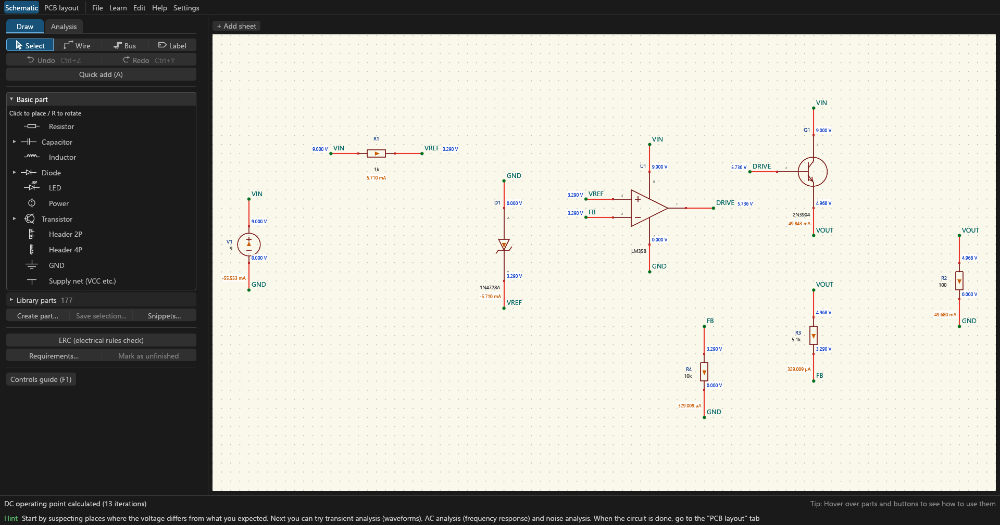

| A lesson: predict first, then simulate | The operation guide (F1) |
|---|---|
| 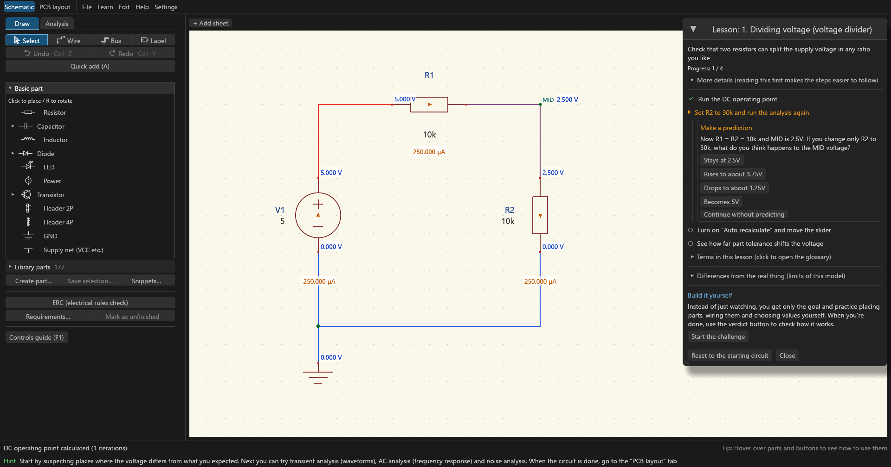 | 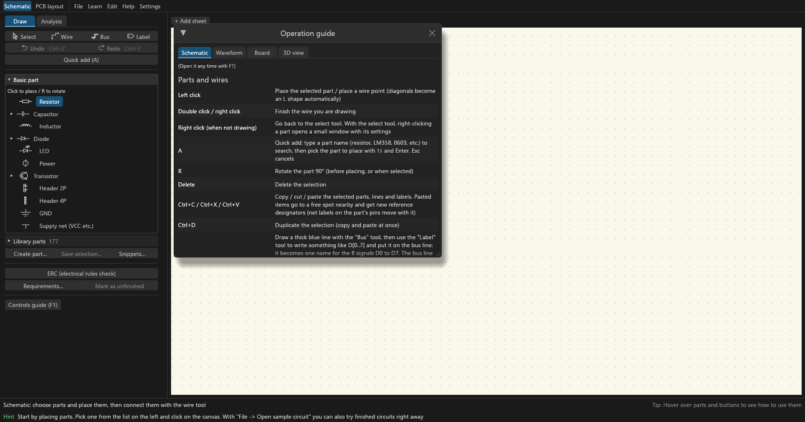 |

A screen recording (about 75 s, Japanese UI): drawing a schematic, simulating it, importing it into a PCB, auto-routing, DRC and the 3D view.

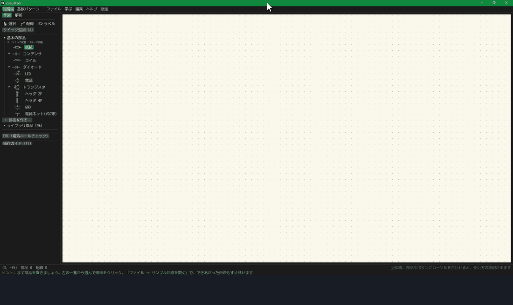

## Who it is for
- People who are new to electronics and find tools like KiCad or LTspice intimidating.
- People who want to **see a circuit run**: voltages are shown as wire colours and currents as arrows, directly on the schematic.
- People who want to know **why** a value was chosen: resistor and converter calculators show their steps and caveats.
- People who want to take their own design **all the way to an order**.

## Features
- **Beginner-friendly.** Every button and field has a hover explanation. Wiring mistakes and rating violations come with the cause and how to fix it. `F1` opens an operation guide.
- **A guided learning path.** "Build a regulated power supply" takes you from the basics to a board and a real-world measurement: 7 learning paths (power supply, Arduino-compatible board, Mega-compatible board, board craft, switching loads, battery-powered devices, signals), 51 step-by-step lessons, 8 board lessons (including repairing a board with a fault put in on purpose), 10 "build it yourself" challenges that check your circuit, and guides for bench experiments. Lessons ask you to predict a result before you simulate it.
- **Learn by breaking things.** Open, short, reverse or change parts and pins, and compare how far the damage spreads.
- **Schematic to fabrication files.** Import into the PCB editor, then place, route (auto-route, push-and-shove, hand routing with cleanup), pour copper, run DRC, view in 3D, run pre-order checks for JLCPCB / PCBWay / OSH Park rules, and export Gerber, drill, BOM and placement files. 2 to 8 copper layers are supported.
- **Simulation:** DC operating point, transient (adaptive time step), AC (Bode plot), DC sweep, noise, poles and zeros, loop gain (phase margin), impedance seen from a net, THD, self-heating over time, parameter sweep, Monte Carlo and worst-case tolerance analysis, temperature effects, fault simulation. Step-response figures include settling times down to a ±0.003 % band.
- **Cross-checked against ngspice.** Results on the bundled examples are compared with the open-source ngspice (DC operating points and transients; stored answers are checked in CI). Numbers, tolerances and known mismatches are on the [accuracy page](docs/accuracy.md) (Japanese). Agreement with real hardware has not been verified.
- **Parts and samples included.** More than 140 parts (power ICs, sensors, batteries, ADCs, low-leakage analog switches and more) and more than 100 sample circuits, including a 41-part mixed-signal demo (power supply + 555 + counter + temperature alarm + amplifier) with a hand-routed board. KiCad symbols and footprints can be imported.
- **Headless use (`ccad`).** Build circuits, run ERC, analyses (operating point, transient, AC, noise, sweeps, part-value sensitivity, poles and zeros, loop gain), boards (placement, routing, requirement checks, pictures) and fabrication files from a one-command-per-line script, with every answer as JSON (made for AI agents and automation). See [docs/cli.md](docs/cli.md) (Japanese).
- **A design-requirements table.** Write net roles, widths and currents, parts that belong together or must stay apart, bypass-capacitor pairs and measures on the copper path (resistance, voltage drop, vias, parallel run) in the schematic; the PCB editor uses them for placement, routing and checks, and shows the result row by row.
- **Multi-sheet schematics,** reusable snippets, copy and paste, and wires that follow a part you drag.
- **Free and open source,** under `AGPL-3.0-or-later` (if you distribute a modified version, or let others use it as a network service, publish its source under the same license).

| Transient waveform | Bode plot (AC analysis) |
|---|---|
| 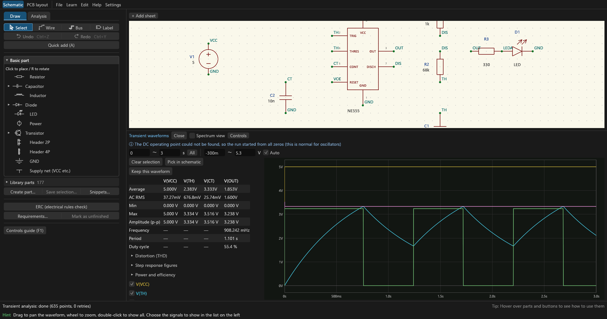 | 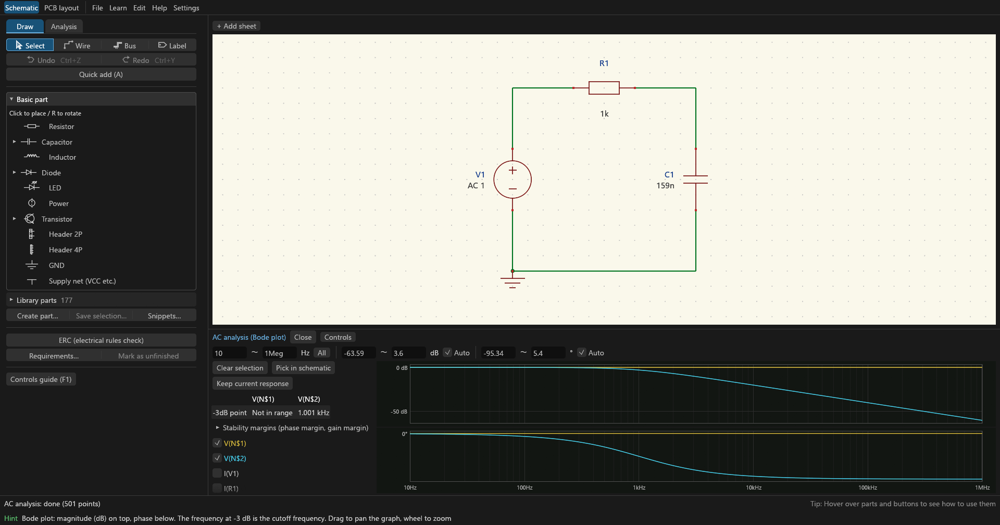 |

| Hand-routed board (41 parts, 249 tracks) | 3D view |
|---|---|
| 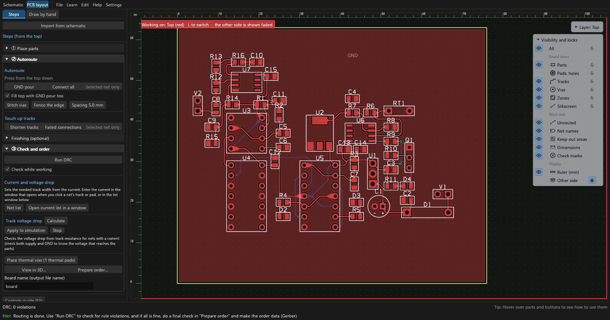 | 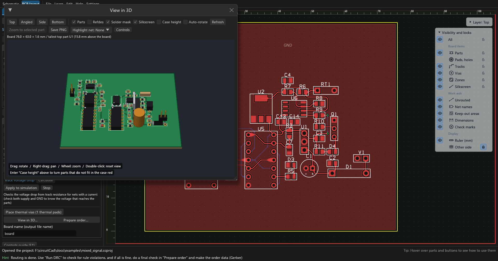 |

| Pre-order check |
|---|
| 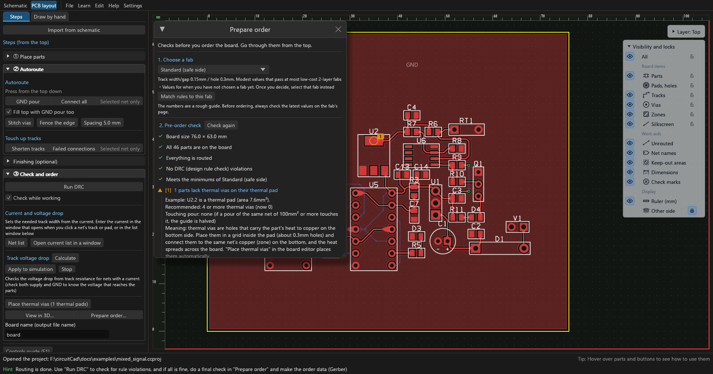 |

| A board with the design requirements imported | The design-requirements table |
|---|---|
| 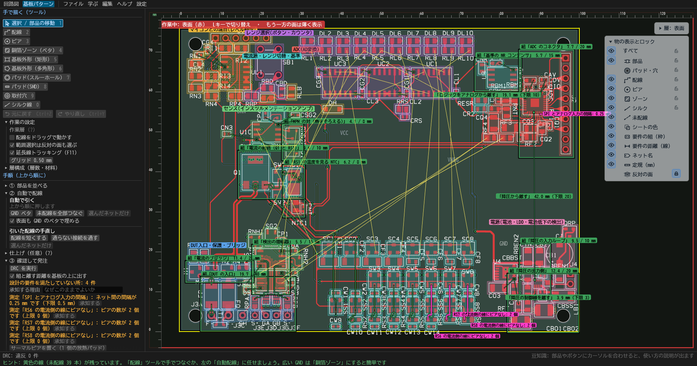 | 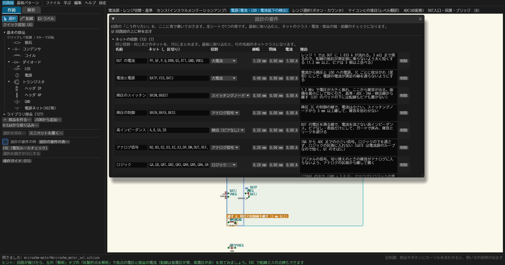 |

These two (Japanese UI) show the author's work-in-progress milliohm meter (3 mΩ to 3 MΩ, 10 ranges, several sheets). Write what you want of the circuit in the table, and on the board it becomes checks for parts that go together, distances and track widths (some tracks are still unrouted and some requirements are not met yet). The design is not verified on hardware and uses makers' models, so its files are not included.

## Headless use (`ccad`)
`ccad` runs circuitCad's calculations without opening a window. A script has **one command per line**: build a circuit by part and pin names, run ERC and analyses, make a board and export fabrication files. Every answer is one JSON object per line, so AI agents and automation can use it.

```
new
add V 5 as=V1
add R 270 as=R1
add LED as=D1
net VCC V1.+ R1.1
net LEDA R1.2 D1.A
net GND V1.- D1.K
erc
dc
```

Save this as `led.ccad` and run `ccad led.ccad`. In the answer of `dc`, `elements.D1.current` is the current through the LED (about 11 mA). If ERC still has errors, `circuit_ok` in the answer is `false`, so you know whether to trust the numbers.

- **It is also an MCP server.** Register it with, for example, `claude mcp add ccad -- ccad --strict mcp`, and an AI agent can call the same commands as tools (`--strict` refuses to analyse a circuit that has ERC errors). Board pictures are returned over MCP too.
- **From source:** `cargo run -p cli -- led.ccad`. The release zips up to `v0.1.0-alpha.8` do not contain `ccad`.
- The command list and the caveats are in [docs/cli.md](docs/cli.md) (Japanese).

## Try it in five minutes
1. Download the zip from the [releases page](https://github.com/K2EXTER/circuitCad/releases), unzip it and run `circuitCad.exe`. Windows SmartScreen may warn about the unsigned executable: choose "More info" then "Run anyway". Use `v0.1.0-alpha.11` or later for the English UI.
2. Choose **Settings → Language / 言語 → English**. The setting is kept for the next start.
3. **File → Open sample circuit → "Make 5V from 12V to light an LED"** (a three-terminal regulator circuit).
4. In the left panel, open the **Analysis** tab and press **Run DC operating point**. Voltages appear as wire colours and numbers, currents as arrows.
5. Select a resistor, turn on **Auto recalculate** and drag its value slider; the result updates live.
6. Open **Learn → Learning path** and start with the first lesson.

## Build from source
You need [Rust](https://www.rust-lang.org/).

```bash
cargo run -p app --release
cargo test --workspace
```

Start it in English with `cargo run -p app --release -- --lang en` (or choose the language in the Settings menu once).

On Linux you also need GTK and related development packages (`libgtk-3-dev`, `libxkbcommon-dev`, `libwayland-dev`, ...). A Japanese font is loaded from the system at runtime, and a bundled one (BIZ UDGothic, SIL OFL 1.1) is used if none is found; in English mode Latin text uses Segoe UI on Windows (DejaVu Sans on Linux) when it is there.

A code map for contributors is in [CLAUDE.md](CLAUDE.md), with per-file notes in [docs/code-notes/](docs/code-notes/). These are written in Japanese (code and comments are in English). How the English UI works, and how to add or fix a translation, is in [docs/code-notes/i18n.md](docs/code-notes/i18n.md) (Japanese): the Japanese text stays in the code as the key of the tables in `crates/i18n/en/*.tsv` (one `Japanese<TAB>English` per line).

## Limitations
- **Tested mainly on Windows 10 / 11.** On Linux, the author built it, launched it and tried basic operation on WSL2 (Ubuntu 26.04, no GPU) only; other distributions and real hardware are untested, and you may need GTK and related runtime libraries. macOS builds and passes the tests in CI, but nobody has launched the app there yet.
- **No board has been manufactured from this software yet.** Gerber and drill export and the pre-order checks exist, but they are unproven in practice. For a first order, use a small quantity and check the result in the fabricator's Gerber viewer.
- **The simulator uses simplified models** and can differ noticeably from real hardware. Each lesson explains the differences.
- **Part data and fabricator rules are approximate.** Always check the datasheet and the fabricator's current page. A part whose land pattern has not been checked against the datasheet is flagged `land_unverified`, and the pre-order check warns about it.
- **Do not use it as the basis for safety-critical designs** (medical, automotive, high voltage, lithium-cell chargers, and so on).
- **The English text is new** and was translated with AI help; some wording may be awkward, and a few messages built at run time may still appear in Japanese. Reports are welcome.
- It is developed by a small team (mostly one person plus an AI assistant), so replies and fixes can be slow.

Use at your own risk. No guarantee is made that a board designed with this software will work or can be manufactured.

## About how it was built
Almost all of the code was written by Claude (via Claude Code); the maintainer operates the app, runs the tests and decides what to build. The English UI text was also translated by Claude, from the Japanese original. The write-up (in Japanese) is on [Zenn](https://zenn.dev/k2exter/articles/d54c59e62156c3).

## Contributing
Bug reports, suggestions and part additions are welcome. See [CONTRIBUTING.md](CONTRIBUTING.md). Issues in English are fine.

## License
Copyright (C) 2026 K2EXTER

[GNU Affero General Public License v3.0 or later](LICENSE-AGPL) (`AGPL-3.0-or-later`). You may use, study, modify and share it freely. If you distribute a modified version, or let others use it as a network service, you must publish its whole source to your users under the same license.

The early versions up to `v0.1.0-alpha.7` were published under `MIT OR Apache-2.0`; those terms still apply to those versions (the license texts are in [legacy-licenses/](legacy-licenses/)).

Unless stated otherwise, contributions you submit are licensed under the same license (AGPL-3.0 or later). The bundled BIZ UDGothic font is distributed under the SIL Open Font License 1.1. Third-party Rust crates and their licenses are listed in [THIRD_PARTY_LICENSES.txt](THIRD_PARTY_LICENSES.txt).
