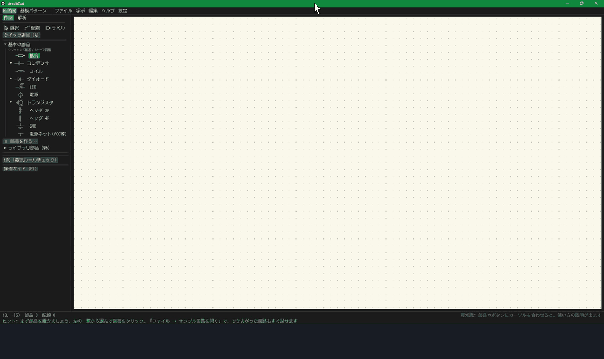

# circuitCad

**English | [日本語](README.md)**

**Draw a schematic, simulate it, turn it into a PCB, and export manufacturing files, all in one free app built for people learning electronics.**

circuitCad combines schematic capture, SPICE-style simulation, PCB layout and Gerber export in a single desktop application. It is aimed at beginners who want to go from "learning a circuit" to "experimenting with it" to "ordering a real board" without switching tools.

> **The user interface is in Japanese only.** Buttons, hints, lessons and error messages are all in Japanese, and there is no translation yet. This page is a summary for people who found the project from outside Japan. If you would like to see an English UI, please open an issue and tell us what you would use it for.

[**Download for Windows**](https://github.com/K2EXTER/circuitCad/releases) (alpha, no installer: unzip and run `circuitCad.exe`)

> **Status: early alpha.** Only tested on Windows. No board made with this software has been manufactured yet. See [Limitations](#limitations) before relying on it.




## Who it is for
- People who are new to electronics and find tools like KiCad or LTspice intimidating.
- People who want to **see a circuit run**: voltages are shown as wire colours and currents as arrows, directly on the schematic.
- People who want to know **why** a value was chosen: resistor and converter calculators show their steps and caveats.
- People who want to take their own design **all the way to an order**.

## Features
- **Beginner-friendly.** Every button and field has a hover explanation. Wiring mistakes and rating violations come with the cause and how to fix it. `F1` opens an operation guide.
- **A guided learning path.** "Build a regulated power supply" takes you from the basics to a board and a real-world measurement: 23 step-by-step lessons, 9 "build it yourself" challenges that check your circuit, and guides for bench experiments.
- **Learn by breaking things.** Open, short, reverse or change parts and pins, and compare how far the damage spreads.
- **Schematic to fabrication files.** Import into the PCB editor, then place, route (auto-route, push-and-shove, hand routing with cleanup), pour copper, run DRC, view in 3D, run pre-order checks for JLCPCB / PCBWay / OSH Park rules, and export Gerber, drill, BOM and placement files. 2 to 8 copper layers are supported.
- **Simulation:** DC operating point, transient (adaptive time step), AC (Bode plot), DC sweep, noise, parameter sweep, Monte Carlo tolerance analysis, temperature effects, fault simulation. Step-response figures include settling times down to a ±0.003 % band.
- **Cross-checked against ngspice.** Results on the bundled examples are compared with the open-source ngspice (DC operating points and transients; stored answers are checked in CI). Numbers, tolerances and known mismatches are on the [accuracy page](docs/accuracy.md) (Japanese). Agreement with real hardware has not been verified.
- **Parts and samples included.** About 100 parts (power ICs, sensors, batteries, ADCs, low-leakage analog switches and more) and 41 sample circuits, including a 41-part mixed-signal demo (power supply + 555 + counter + temperature alarm + amplifier) with a hand-routed board. KiCad symbols and footprints can be imported.
- **Headless use (`ccad`).** Build circuits, run ERC, analyses (operating point, transient, AC, noise, sweeps, part-value sensitivity), boards and fabrication files from a one-command-per-line script, with every answer as JSON (made for AI agents and automation). See [docs/cli.md](docs/cli.md) (Japanese).
- **Free and open source,** under `AGPL-3.0-or-later` (if you distribute a modified version, or let others use it as a network service, publish its source under the same license).

| Transient waveform | Bode plot (AC analysis) |
|---|---|
|  |  |

| Hand-routed board (41 parts, 249 tracks) | 3D view |
|---|---|
|  |  |

(Screenshots show the Japanese UI.)

## Try it in five minutes
1. Download the zip from the [releases page](https://github.com/K2EXTER/circuitCad/releases), unzip it and run `circuitCad.exe`. Windows SmartScreen may warn about the unsigned executable: choose "More info" then "Run anyway".
2. Open `docs/examples/regulator_led.schjson` from the file menu (a circuit that makes 5 V from 12 V and lights an LED).
3. In the left panel, open the analysis tab and run the DC operating point. Voltages appear as wire colours and numbers, currents as arrows.
4. Select a resistor and drag its value slider with auto-recalculation on; the result updates live.
5. Open the lesson menu and try the first lesson.

## Build from source
You need [Rust](https://www.rust-lang.org/).

```bash
cargo run -p app --release
cargo test --workspace
```

On Linux you also need GTK and related development packages (`libgtk-3-dev`, `libxkbcommon-dev`, `libwayland-dev`, ...). A Japanese font is loaded from the system at runtime, and a bundled one (BIZ UDGothic, SIL OFL 1.1) is used if none is found.

A code map for contributors is in [CLAUDE.md](CLAUDE.md), with per-file notes in [docs/code-notes/](docs/code-notes/). These are written in Japanese (code and comments are in English).

## Limitations
- **Tested on Windows 10 / 11 only.** macOS and Linux build and pass the tests in CI, but nobody has launched the app there yet.
- **No board has been manufactured from this software yet.** Gerber and drill export and the pre-order checks exist, but they are unproven in practice. For a first order, use a small quantity and check the result in the fabricator's Gerber viewer.
- **The simulator uses simplified models** and can differ noticeably from real hardware. Each lesson explains the differences.
- **Part data and fabricator rules are approximate.** Always check the datasheet and the fabricator's current page. A part whose land pattern has not been checked against the datasheet is flagged `land_unverified`, and the pre-order check warns about it.
- **Do not use it as the basis for safety-critical designs** (medical, automotive, high voltage, lithium-cell chargers, and so on).
- It is developed by a small team (mostly one person plus an AI assistant), so replies and fixes can be slow.

Use at your own risk. No guarantee is made that a board designed with this software will work or can be manufactured.

## About how it was built
Almost all of the code was written by Claude (via Claude Code); the maintainer operates the app, runs the tests and decides what to build. The write-up (in Japanese) is on [Zenn](https://zenn.dev/k2exter/articles/d54c59e62156c3).

## Contributing
Bug reports, suggestions and part additions are welcome. See [CONTRIBUTING.md](CONTRIBUTING.md). Issues in English are fine.

## License
Copyright (C) 2026 K2EXTER

[GNU Affero General Public License v3.0 or later](LICENSE-AGPL) (`AGPL-3.0-or-later`). You may use, study, modify and share it freely. If you distribute a modified version, or let others use it as a network service, you must publish its whole source to your users under the same license.

The early versions up to `v0.1.0-alpha.7` were published under `MIT OR Apache-2.0`; those terms still apply to those versions (the license texts are in [legacy-licenses/](legacy-licenses/)).

Unless stated otherwise, contributions you submit are licensed under the same license (AGPL-3.0 or later). The bundled BIZ UDGothic font is distributed under the SIL Open Font License 1.1. Third-party Rust crates and their licenses are listed in [THIRD_PARTY_LICENSES.txt](THIRD_PARTY_LICENSES.txt).
