# circuitCad

**[English](README.en.md) | 日本語**

**回路図を描いて、動かして、基板にして、発注データまで出す。電子回路を学びながら、1本のソフトで。**

回路図、SPICE シミュレーション、ブレッドボードでの試作、基板設計、製造データ (Gerber) の出力、届いた基板の電源投入と測定までを、1つのアプリにまとめた**日本語の回路 CAD** です。画面は作る順に **回路図 → 試作 → 基板 → 実機** の 4 つのタブに分かれています。電子工作を始めたばかりの人が、「回路を学ぶ → 実験する → 基板を作って発注する → 動かす」までを、ソフトを乗り換えずにつなげて歩けることを目指しています。

[**⬇ Windows 版をダウンロード**](https://github.com/K2EXTER/circuitCad/releases) (アルファ版・インストール不要・zip を展開して `circuitCad.exe` を起動)

紹介ページ: <https://k2exter.github.io/circuitCad/>

開発の経緯 (AI を使って、1週間で作った記録) は、Zenn の記事にまとめています: [Claude Codeで1週間・約5万行: 初学者向けの回路CAD「circuitCad」をRustで作った記録](https://zenn.dev/k2exter/articles/d54c59e62156c3)

> **状態: 初期バージョン (アルファ)。** 動作確認は Windows だけで、基板の発注の実績もまだありません。使う前に、下の「[現在の状態と既知の制限](#現在の状態と既知の制限)」を読んでください。

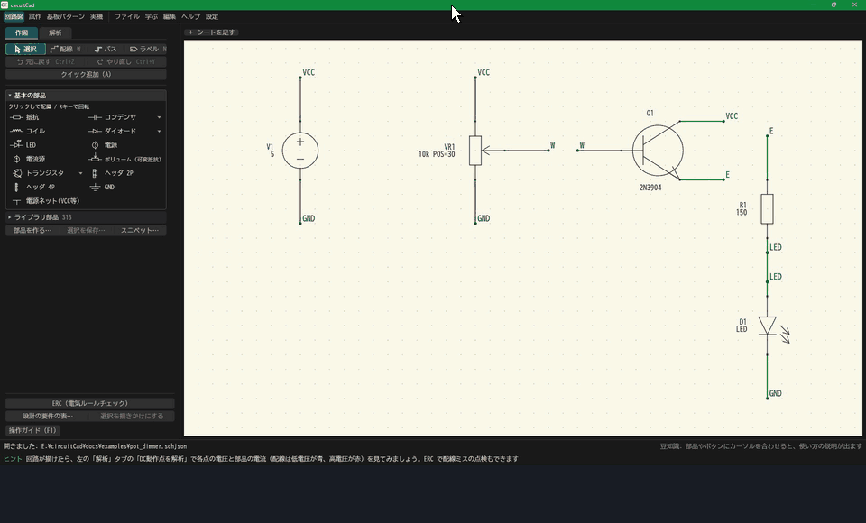

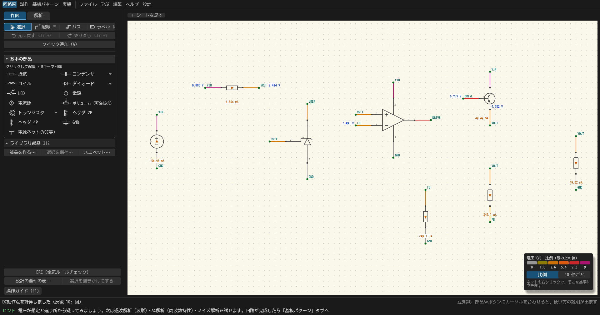

## どんな人に向いているか
- 電子工作や回路の勉強を始めたばかりで、**KiCad や LTspice のような専門ソフトは、入り口が高い**と感じている人
- 回路図を描くだけでなく、**動かして確かめたい**人 (電圧は配線の色、電流は矢印で、回路図の上にそのまま出ます。ブレッドボードに差した絵の上でも、電源を入れると LED が光ります)
- 「なぜその値なのか」を知りたい人。抵抗値の決め方は、計算の手順と注意点つきで出ます
- 自分で設計した基板を、**発注するところまで**やってみたい人

## 特長
- **日本語で、迷わない。** 画面もメッセージも日本語です。ボタンや入力欄にポインタを置くと説明が出て、配線ミスや定格オーバーは「原因と直し方」つきで知らせます。`F1` で操作ガイドが開きます。 英語の画面にも切り替えられます (メニュー「設定」→「Language / 言語」。alpha.11 から)。
- **学びながら進める。** 学習パス9本 (安定化電源・Arduino 互換ボード・Mega 互換ボード・基板の作法・スイッチング負荷・電池で動く機器・信号・部品・修理) を、入門から基板・実機まで順に進められます。手順つきレッスン90本以上、基板のレッスン8本、自分で回路を作って判定される「作ってみよう」10本、実機で確かめる実験の案内も付いています。手順の前に結果を予想する問いが出て、基板に故障を仕込んで直す練習もできます。デジタル回路は、スイッチをクリックしながら High / Low の色と真理値表で確かめられます。
- **ブレッドボードで試せる。** 「試作」のタブで、回路図の部品をブレッドボードのどの穴に差すかを自動で並べます。電源を入れると差したとおりの回路が動き、LED が光り、ボリュームが回り、ブザーが鳴り、定格を超えた部品は焦げます (alpha.12 から)。
- **壊して学べる。** 部品やピンを断線・ショートさせて、何が起きるか、どこまで壊れが広がるかをシミュレーションで比べられます。
- **回路図から発注データ、届いた基板まで1本。** 回路図から基板に取り込み、配線 (自動配線・押しのけ配線・手で引いた線のきれいな仕上げ)、ベタ、DRC、3D 表示、発注先 (JLCPCB / PCBWay / OSH Park) のルールに合わせた発注前チェック、Gerber・ドリル・BOM の書き出しまで、同じアプリでできます。届いた基板は「実機」のタブで、組み立て → 電源投入 (正常なら流れる電流と、電流制限に入れる値) → 測る → 合否 → 修理 の順に進めます。
- **シミュレーションの答え合わせをしている。** オープンソースの ngspice と結果を比べて確かめています (開発用の `--xcheck`)。 何をどれだけ比べて何が合わないかは、[精度のページ](docs/accuracy.md)に数字で書いています (実物との一致は未確認です)。
- **部品とサンプルが付いている。** 260部品以上 (電源 IC、センサ、電池、ADC、アナログスイッチ、メーカーの実物のチップ抵抗・コンデンサ・インダクタ・LED・MOSFET など。値違いはシリーズとしてまとめて、さらに多くの値を選べます) とサンプル回路130本以上 (部品41個の総合デモ「電源 + 555 + カウンタ + 温度アラーム + アンプ」と、その手で配線した基板つき)。同梱の部品のモデルは、データシートの表とグラフに合わせて作っています。KiCad のシンボル・フットプリント・回路図と、LTspice の回路図 (.asc) も取り込めます。
- **無料で、ソースが読める。** AGPL-3.0 以降のライセンスで公開しています (改変したものを配る・サービスとして使わせるときは、そのソースも同じライセンスで公開してください)。

## 3ステップで試す
1. 上のリンクから zip をダウンロードして展開し、`circuitCad.exe` を起動します。
2. 起動したときのカードの「最初のレッスンを始める」を押します (メニュー「学ぶ」→「部品の素顔」→「0. はじめに」からも選べます)。最初のレッスンは、電圧・電流・抵抗の関係 (オームの法則) です。手順に沿って押していくと、シミュレーションの結果が回路図に重なって出ます。
3. 慣れたら「学ぶ → 学習パス」で、安定化電源づくりに進みます。

もう少し詳しい手順は、下の「[最初の5分](#最初の5分)」にあります。

## できること
- **回路図**: 部品の配置と配線 (部品を動かすと配線が付いてくる)、Undo/Redo、コピー&貼り付け、選んだ部分を保存して再利用 (スニペット)、複数のシート (タブ)、ERC (配線ミスの点検。原因と直し方つき。意図して未接続のピンには NC の印)。電源は値に応じて、直流 (±) / 交流 (正弦波) / パルス (方形波) の記号で描き分けます
- **試作 (ブレッドボード)**: 回路図の部品を差す穴を自動で並べ、つながっている穴を光らせます。部品やジャンパー線はドラッグで差し替えられ、回路図と違う差し方 (ショート・つながっていない足) は赤い丸と一覧で知らせます。電源を入れると差したとおりの回路が動き、電源の電圧・周りの温度・ボリュームを動かしたまま変えられます。スイッチと押しボタンはクリックで切り替わり、ブザーはスピーカーから鳴り、定格を超えた部品は焦げて回路の中でも壊れます。テスターとオシロの道具付き
- **実機**: 届いた基板を、組み立て → 電源投入 → 測る → 合否 → 修理 の手順で進めます。手順ごとに、基板の配置図で付ける部品や測る点が光ります。最初の電源投入では、回路図から「正常なら流れる電流」の範囲と電流制限の値を出し、測った電流が多い・少ないときに疑う所を並べます。はんだ付けの順と向きの印の組み立て表 (印刷用の SVG) も作れます
- **シミュレーション**: DC 動作点 / 過渡 / AC (ボード線図) / DC スイープ / ノイズ / 極と零 / 根軌跡 / ループゲイン (位相余裕・ナイキスト線図・ニコルス線図) / ネットから見たインピーダンス / ひずみ率 (THD) / 同相除去比 (CMRR)・電源除去比 (PSRR) / 感度 / 電池の持ち時間 / 抵抗と部品の自己発熱 (θjc と放熱板、周りの温度を振る最悪ケース、温度の時間変化も)。過渡解析の波形には、ロジックアナライザのようなデジタル表示 (High / Low の帯とバス) もあります。シミュレーションが仮定していること (モデルの前提) も一覧で見られます。結果を回路図に重ねて表示 (電圧は配線の色、電流は矢印)。過渡解析は、波形の曲がり具合を見て時間刻みを自動で細かくします (指定した刻みは「最大の刻み」)
- **波形の見方**: 横軸・縦軸を別々に拡大縮小、測定カーソル (2点の差と周期)、電圧と電流を回路図のクリックで追加
- **実験**: 部品値のスライダー (動かせる幅を選べます) と「自動で再計算」、温度の影響、部品の誤差のばらつき (モンテカルロ。合格率と Cpk) と最悪ケース解析、ステップ応答の指標 (立ち上がり・行き過ぎ・整定時間。±1 % から ±0.003 % の幅に入るまでの時間も)
- **故障の学習**: 部品やピンを壊して (断線・ショート・逆向き・値の変化) 影響を比べる故障シミュレーション、動かない回路で測った電圧から原因を探す故障診断、部品1つの値を振るパラメータスイープ
- **定格のチェック**: 抵抗や IC の発熱が形の目安を超えていないか、LED の電流が多すぎないかなどを、解析の結果から警告します
- **値の決め方**: LED の抵抗、分圧、RC フィルタ、レギュレータ、トランジスタ・MOSFET のスイッチ、降圧・昇圧コンバータ、オペアンプの増幅、放熱 (要る銅の面積・放熱板) などを、計算の手順と注意点つきで求めます。アクティブフィルタ (バターワース・ベッセル・チェビシェフ) は部品を決めて回路図に置き、AC 解析で目標と比べます
- **熱**: 基板を升目に分けて銅・ビア・対流・放射から温度を解く熱の地図 (時間の変化、3D ビューの温度の色、閉じたケースに入れたときの温度上昇も)。結果は回路図の自己発熱に戻せます
- **学習**: メニュー「学ぶ」の学習パス9本 (入門から基板・実機・修理まで順に学び、進み具合が残ります) と、手順つきレッスン90本以上・基板のレッスン8本。デジタル回路を動かしながら見るモード (スイッチをクリック、High / Low の色、真理値表、1 クロックずつ進める、ゲートの遅れを引き延ばしてグリッチを見る)。実機で確かめる実験の案内と、自分で回路を作って判定する「作ってみよう」(一部のレッスン) も付いています (分圧、LED、RC フィルタ、トランジスタ、555、RLC、リチウムイオン充電、オペアンプ、整流、電池、降圧コンバータ、MOSFET、PNP のハイサイドスイッチ、ダイオードの特性、ツェナー、直列レギュレータ、78xx、熱と定格、保護回路、コイルの層間ショート、可変電源など全10本)
- **基板**: 回路図から取り込み、配置、配線、DRC、3D 表示。取り込んだあとの流れを助ける機能が揃っています。
  - **配線**: 自動経路 (行き先のパッドまでの道を、よけながら探して見せる)、押しのけ配線 (別のネットの線を脇へ寄せて通す)、簡易自動配線、45° / 直角 / 自由の曲げ方、パッドへの垂直な出入り (2本は両端寄せ)、長さ合わせ (蛇行)、差動ペア
  - **仕上げ**: 配線の角丸め、太さの段差のなだらか化、涙型、パッドの首、分かれ目の凹みの補正、並走する同ネットのすき間埋め。ネットクラスごとに変えられ、表示・DRC・Gerber の出力に同じ形が使われます
  - **設計の要件の表**: 回路図に、ネットの役割・太さ・電流、近くに置く組、離す組、バイパスコンデンサの対応、配線の道筋の測定 (抵抗・電圧降下・ビアの数・並走など)、承知した例外を書くと、基板に取り込んで自動配置・自動配線・点検に使われ、行ごとの結果が回路図と基板に出ます
  - **ネット**: ネットをクリックすると、流れる電流・推奨の線幅・ネットクラス・仕上げの窓が開きます
  - **ベタ (銅箔ゾーン)**: 基板の外形で切り取り、別ネットの配線・パッド・ビアとクリアランスをあけ、サーマルリリーフ、孤立した銅の除去、図形 (直線・円弧) の編集と切り抜き、重なった別ネットのゾーンの優先順位 (「最前面へ / 最背面へ」)。**多層基板 (2 / 4 / 6 / 8 層。内層に配線とベタ)**
  - **確認**: DRC、IC の電源ピンのコンデンサ、鋭角な配線、サーマルビア、配線の太さ (電流から)、配線の電圧降下
  - **画面**: 右上のガラス板で、層の表示と作業層、見える物・選べる物をアイコンで切り替え。左パネルは、選んだツールの設定がボタンの真下に開きます
  - **複数の基板**: 1 つのプロジェクトに複数の基板を入れ、基板どうしのつなぎを照合し、3D で重ね、全体をシミュレーションできます
  - **3D と STEP**: GPU で描く 3D ビュー、曲面と部品ごとの組み立ての STEP の書き出し、ケースの STEP を重ねてぶつかる部品を出す。配線のインピーダンスは断面の電界ソルバで求めます
- **発注**: 発注先 (JLCPCB / PCBWay / OSH Park) のルールに合わせる、発注前チェック (IC の電源ピンのコンデンサ、鋭角な配線なども)、出来上がりプレビュー、Gerber・ドリル・BOM・部品位置の書き出し、注文手順
- **画面なしの操作 (`ccad`)**: 回路の作成・ERC・解析 (動作点・過渡・AC・ノイズ・スイープ・部品値の感度・極と零・ループゲインなど)・基板 (配置・配線・要件の点検・画像での確認)・購入リスト・製造データを、1行1コマンドのスクリプトで実行して、答えを JSON で返します。AI エージェントや自動化向けです。使い方は [docs/cli.md](docs/cli.md)
- **部品ライブラリ**: 260 部品以上 (記号・パッケージ・シミュレーションモデル。電源 IC、センサ、電池、ADC、低リークのアナログスイッチ、KOA・ROHM・Vishay・Yageo・Panasonic のチップ抵抗、Murata の積層セラミック、Panasonic・Nichicon・Rubycon の電解コンデンサ、Bourns のパワーインダクタ、Kingbright の LED、Infineon の MOSFET なども)。モデルはデータシートから作り、どのデータシートから作ったかと表の値とのずれを画面で見られます。ランドパターンをデータシートで確かめていない部品 (`land_unverified`) は、発注前チェックが注意します。JSON で追加できるほか、KiCad のシンボルとフットプリントも取り込めます (`docs/part-format.md`)
- **データシートから部品を作る**: PDF を開いて「データシートから下書き」で、パッケージ・ピンの表・寸法表・推奨パッド・絶対最大定格・熱の値を読み、「グラフから読む」で図の曲線をたどってモデルに合わせます。画像だけの PDF は Windows の文字認識で読みます。MOSFET・トランジスタ・フォトカプラ・オペアンプ・レギュレータ・論理式のロジック IC などは、表の値からかんたんに作れます
- **精度の確認 (開発用)**: シミュレーションは、オープンソースの ngspice と比べて確かめています。`circuitCad --xcheck docs/examples` で、同梱サンプルの動作点 (電圧と電流) が ngspice と一致するか調べられます (`--tran` で過渡波形。ngspice が別に必要です)。結果と既知の差は [docs/code-notes/app/basics.md](docs/code-notes/app/basics.md) にあります

| 試作 (ブレッドボードで動かす) | 実機 (届いた基板の電源投入) |
|---|---|
| 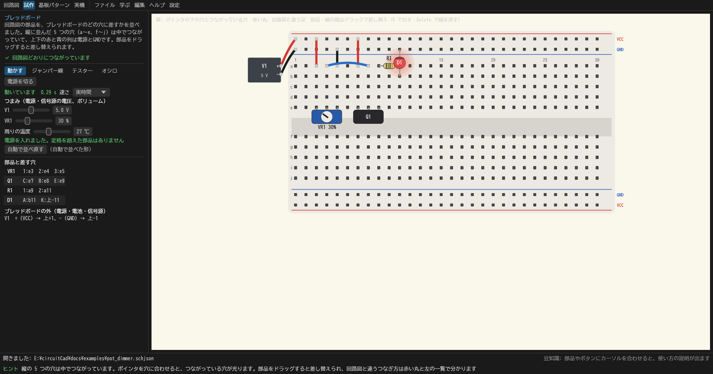 | 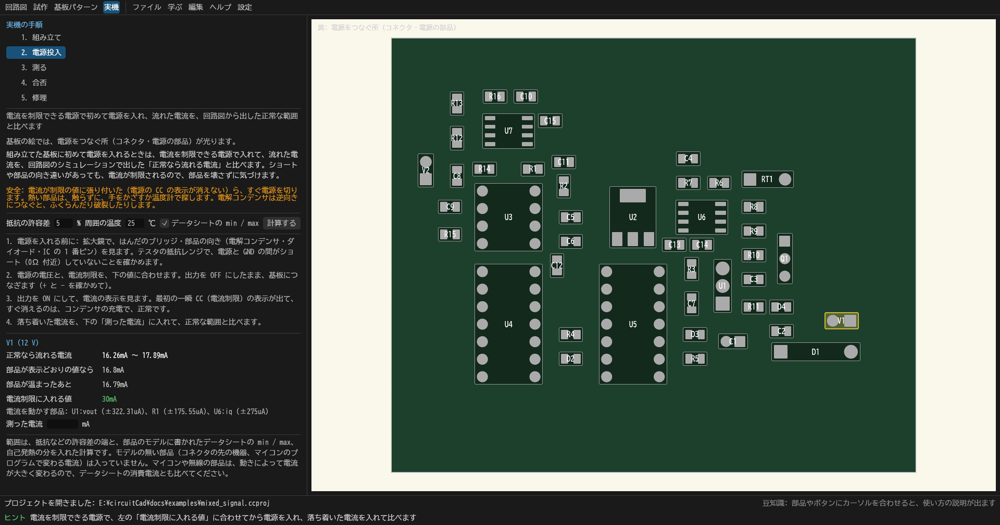 |

| 波形 (過渡解析) | ボード線図 (AC 解析) |
|---|---|
| 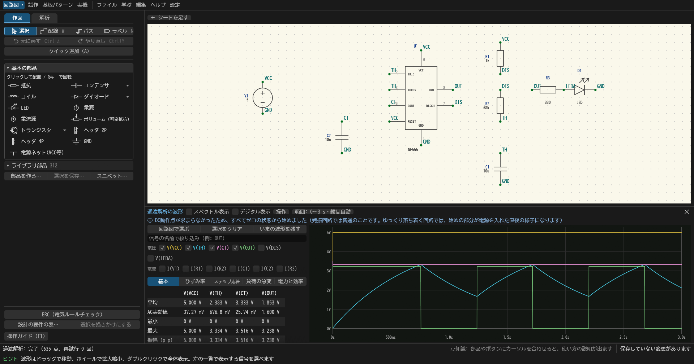 | 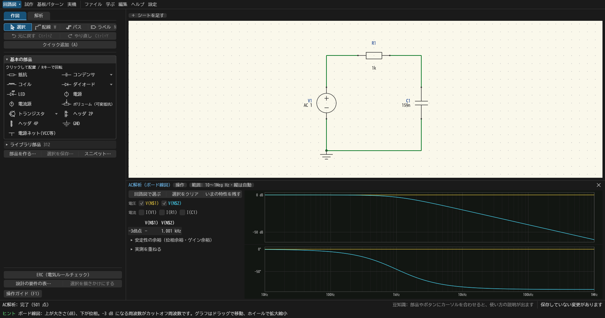 |

| 手で配線した基板 (総合デモ: 部品41個・配線249本) | 3D 表示 |
|---|---|
| 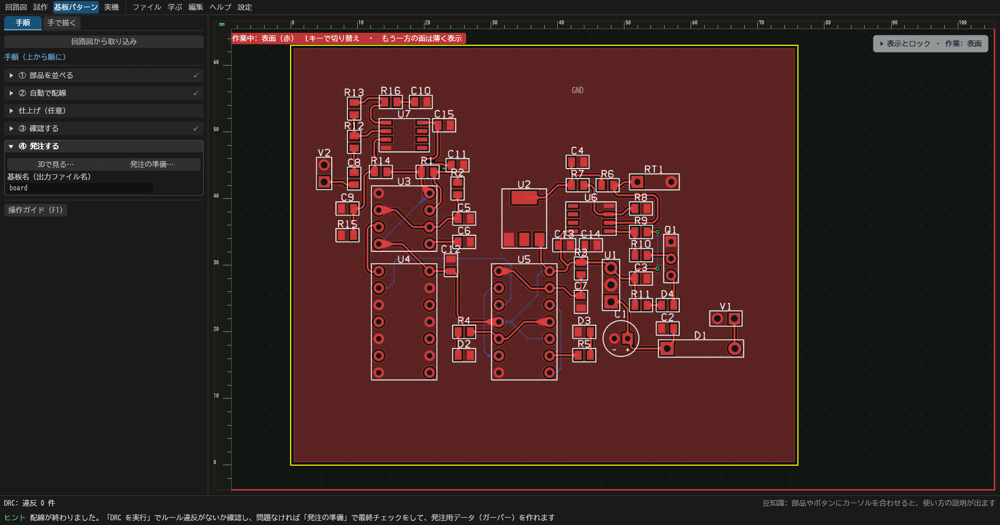 | 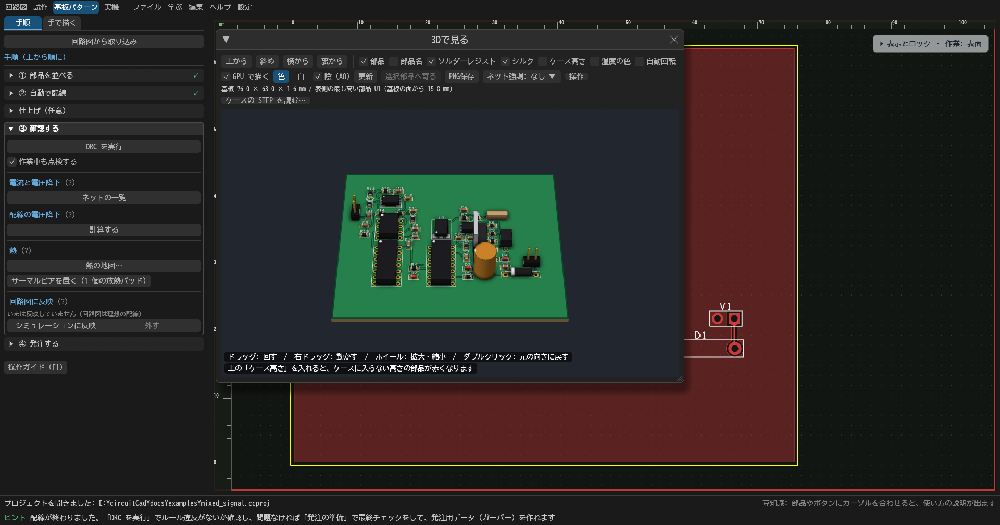 |

| 発注の準備 | 総合デモの回路図と波形 |
|---|---|
| 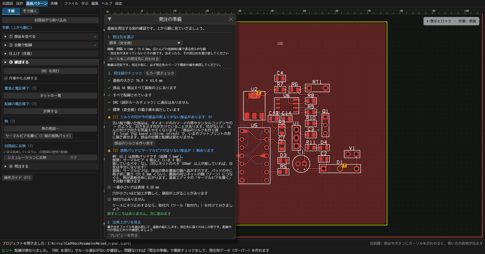 | 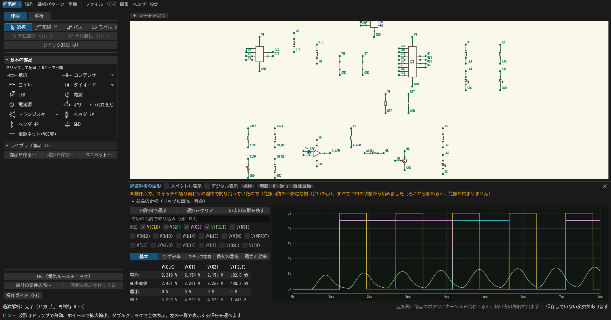 |

| 「設計の要件」を取り込んだ基板 | 「設計の要件」の表 |
|---|---|
| 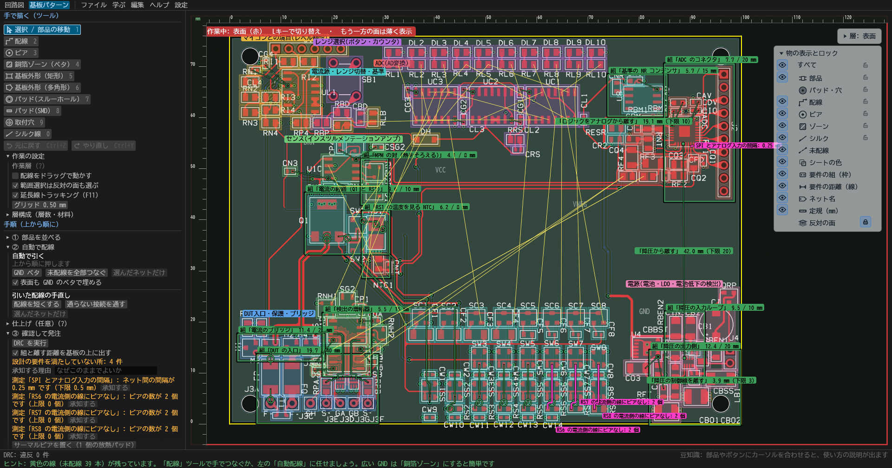 | 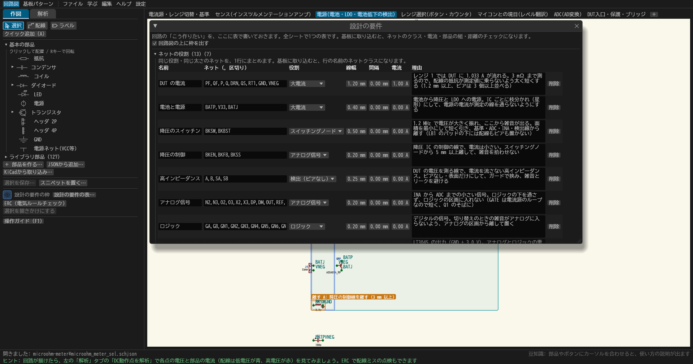 |

この2枚は、作者が作成中の抵抗計 (3 mΩ 〜 3 MΩ、10 レンジ・複数シート) の画面です。回路の「こう作りたい」を表に書くと、基板に取り込んだときに、近くに置く組・離す距離・配線の太さのチェックになります (未配線が残っていて、要件を満たしていない所も出ています)。実機の検証は済んでおらず、メーカーのモデルを使うので、この設計のファイルは同梱していません。

## 画面なしで使う (`ccad`)
`ccad` は、窓を開かずに circuitCad の計算を使うコマンドです。**1行に1コマンド**のスクリプトで、回路を名前で組み立て、ERC・解析・基板・製造データまでを実行します。答えは1行に1つの JSON で返るので、AI エージェントや自動化から扱えます。

```
new
add V 5 as=V1
add R 270 as=R1
add LED as=D1
net VCC V1.+ R1.1
net LEDA R1.2 D1.A
net GND V1.- D1.K
erc
dc
```

これを `led.ccad` として保存し、`ccad led.ccad` で実行します。`dc` の答えの `elements.D1.current` が LED に流れる電流 (約 11 mA) です。ERC にエラーが残っていると、答えの `circuit_ok` が `false` になり、数値を信用してよいかが分かります。

- **MCP サーバーにもなります。** `claude mcp add ccad -- ccad --strict mcp` のように登録すると、AI エージェントが同じコマンドをツールとして呼べます (`--strict` は、ERC にエラーがあるとき解析を断ります)。基板の画像も MCP で返ります。
- **ソースから動かす場合:** `cargo run -p cli -- led.ccad`。リリースの zip には `v0.1.0-alpha.8` までは入っていません。
- コマンドの一覧と注意点は [docs/cli.md](docs/cli.md) にあります。

## 最初の5分
1. 起動して、メニュー「ファイル → 開く」から `docs/examples/regulator_led.schjson` を開きます (12V から 5V を作って LED を光らせる回路)。
2. 左パネルの「解析」タブで「DC動作点を解析」を押すと、各点の電圧が配線の色と数字で、電流が矢印で出ます。
3. 左の「作図」タブで抵抗 R1 を選んで、値のスライダーを動かします。「自動で再計算」をオンにすると、動かしながら結果が変わります。
4. メニュー「学ぶ」から、手順つきのレッスンを選んでみましょう。
5. 操作で迷ったら、`F1` キー (またはメニュー「ヘルプ」) で操作ガイドが開きます。ボタンや入力欄にポインタを置くと、その説明が出ます。

## 動かす
### ビルド済みの実行ファイル (Windows)
[リリースのページ](https://github.com/K2EXTER/circuitCad/releases) から、最新の `circuitCad-windows-x64.zip` をダウンロードして展開し、`circuitCad.exe` を起動してください。インストールは要りません。

- いまは**プレリリース (アルファ版)** です。Windows 用が主で、Linux 用 (`circuitCad-linux-x64.zip`) も付きます (下の「現在の状態と既知の制限」を読んでください)。macOS 用は、動作を確かめてから追加します。
- 実行ファイルには署名がないので、Windows の SmartScreen が警告を出すことがあります。「詳細情報 → 実行」で起動できます。
- 展開したフォルダの `docs/examples/` に、サンプル回路があります。総合デモの基板は `mixed_signal.ccproj` (「ファイル → プロジェクトを開く」)。

### ソースからビルドする
[Rust](https://www.rust-lang.org/) が必要です。

```bash
cargo run -p app --release
cargo test --workspace
```

Linux では、ビルドに GTK などの開発用パッケージ (`libgtk-3-dev`、`libxkbcommon-dev`、`libwayland-dev` など) が必要です。

日本語の表示には、システムの日本語フォント (Windows: BIZ UDゴシック / メイリオ / 游ゴシック、macOS: ヒラギノ、Linux: Noto Sans CJK / IPA など) を実行時に読み込みます。見つからないときは、同梱の BIZ UDゴシック (モリサワ、SIL Open Font License 1.1。`crates/app/assets/fonts/OFL.txt`) を使うので、どの OS でも日本語が表示されます。

サンプル回路は `docs/examples/` にあります (アプリの「ファイル → 開く」から読み込めます)。使い方は `docs/` を見てください。

起動引数で、ファイルを開いたり解析を実行したりもできます (例: `circuitCad docs/examples/rlc_pulse.schjson --tran 20m 20u`。画像として保存するなら `--screenshot out.png`)。一覧は `crates/app/src/args.rs` の `apply_args` にあります。

## 現在の状態と既知の制限
これは初期バージョンです。次のことが、まだできていない・確認できていません。

- **動作確認は Windows (10 / 11) が中心です。** Linux は、WSL2 の Ubuntu 26.04 でビルド・起動・基本の操作を確かめただけで (GPU のない環境、1人分の確認)、他のディストリビューションや実機は未確認です。zip を展開したら、GTK などの実行用ライブラリが要ることがあります (「ソースからビルドする」の Linux の項と同じ)。macOS は、ビルドの設定と CI のテストだけで、起動は試していません。
- **画面 (UI) は改善の途中です。** いちばん力を入れて直している所で、配置・言葉づかい・アイコン、回路図と基板と各窓の見た目と操作をそろえることを、版ごとに進めています。ただ、文字や項目が多くて詰まったパネルや、ほかとそろっていない画面がまだ残っています。分かりにくかった所を教えてもらえると助かります。
- **基板の発注の実績はありません。** Gerber・ドリルの書き出しと発注前チェックは作ってありますが、このソフトで作ったデータで実際に製造してもらったことはまだありません。初めて発注するときは、少量・少額で試し、発注先のプレビュー (ガーバービューア) でも確かめてください。
- **シミュレーションは簡易なモデルです。** 実物と大きくずれる場面があります。ずれの理由は、各レッスンの「実物との違い」に書いてあります。
- **部品の数値は概算です。** ライブラリのピン配置・寸法・モデル、発注先ルールの数値は目安です。
- **画面と説明文は、開発者の使い方でしか確かめていません。** 分かりにくい所や間違いは、Issue で教えてください。
- **開発は少人数です。** 返事や修正が遅れることがあります。

## 注意
- **設計・発注はすべて自己責任です。** 基板が正しく動くこと、製造できることは保証しません。
- 部品ライブラリのピン配置・寸法・モデルの数値、発注先ルールの数値は**概算・目安**です。使う前に、必ずデータシートと発注先の最新のページで確認してください。
- シミュレーションは簡易なモデルです。安全に関わる用途 (医療・車載・高電圧・リチウム電池の充電装置など) の根拠にしないでください。
- 定格のチェックは、パッケージごとの一般的な目安との比較です。実際の定格は、データシートで確認してください。

## ライセンス
Copyright (C) 2026 K2EXTER

[GNU Affero General Public License v3.0 以降](LICENSE-AGPL) (`AGPL-3.0-or-later`) です。使う・調べる・改変する・配るのは自由です。改変したものを配るとき、またはネットワーク越しのサービスとして使わせるときは、そのソース全体を、同じライセンスで利用者に公開してください。

`v0.1.0-alpha.7` までの初期のバージョンは `MIT OR Apache-2.0` で公開しました。その条件は、そのバージョンについてはそのまま有効です (ライセンスの全文は [legacy-licenses/](legacy-licenses/))。

特に明記がなければ、あなたがこのプロジェクトに提出した変更は、同じライセンス (AGPL-3.0 以降) で提供されたものとして扱います。

同梱の日本語フォント (BIZ UDゴシック) は、別に SIL Open Font License 1.1 の下で配布されています。

このソフトがビルドに使っているオープンソースのライブラリ (Rust のクレート) とそのライセンスは、[THIRD_PARTY_LICENSES.txt](THIRD_PARTY_LICENSES.txt) にまとめてあります。配布する実行ファイルには、このファイルを同梱します。

## 開発・支援
- バグ報告・提案・部品の追加は大歓迎です。[CONTRIBUTING.md](CONTRIBUTING.md) をご覧ください。
- 開発の支援は GitHub Sponsors で受け付けています。リポジトリの **Sponsor** ボタンから支援できます。いただいた支援は、開発の時間と、ライブラリ部品の検証に使う予定です。
- 作り方 (AI との開発の進め方・失敗も含めて) は、[Zenn の記事](https://zenn.dev/k2exter/articles/d54c59e62156c3) に書きました。
- コードの地図は [CLAUDE.md](CLAUDE.md)、各ファイルの詳しい説明は [docs/code-notes/](docs/code-notes/) にあります (AI アシスタント向けに書いたものですが、人が読んでも構成をつかめます)。
