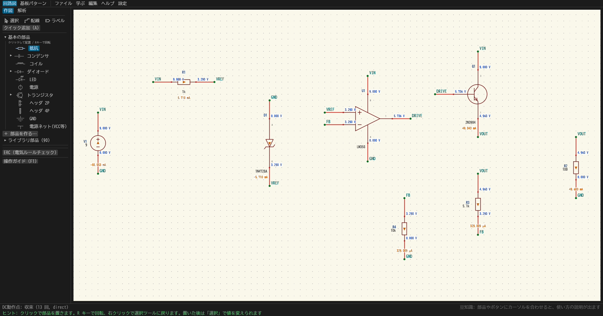
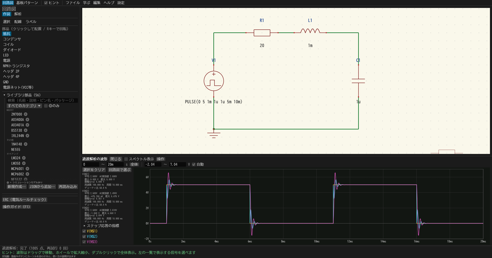
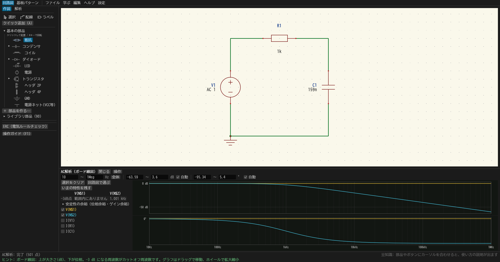
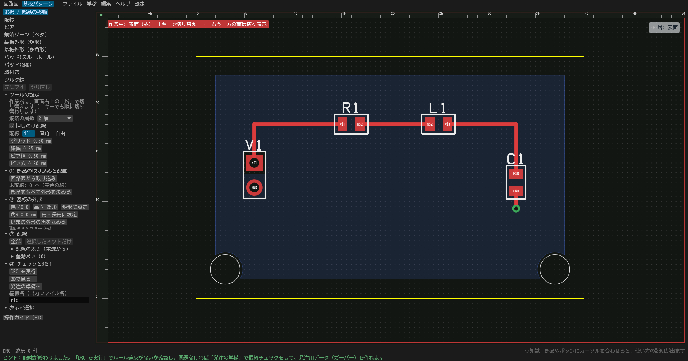
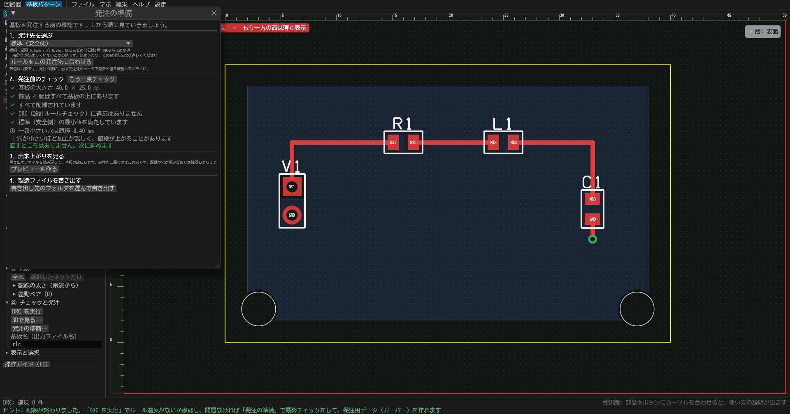

# circuitCad

**回路を学びながら、実験して、基板を発注するところまで。** 回路図・SPICE シミュレーション・基板設計・製造データ (Gerber) の出力を、1本のソフトで行う学習向けの回路 CAD です。
専門ソフトに分かれていて入り口が高い道のりを、初学者がつなげて歩けるようにすることが目的です。画面は日本語で、ボタンや入力欄にポインタを置くと説明が出ます。

> **状態: 初期バージョン (アルファ)。** 動作確認は Windows だけで、基板の発注の実績もまだありません。使う前に、下の「[現在の状態と既知の制限](#現在の状態と既知の制限)」を読んでください。



## できること
- **回路図**: 部品の配置と配線、Undo/Redo、ERC (配線ミスの点検。原因と直し方つき)。電源は値に応じて、直流 (±) / 交流 (正弦波) / パルス (方形波) の記号で描き分けます
- **シミュレーション**: DC 動作点 / 過渡 / AC (ボード線図) / DC スイープ / ノイズ。結果を回路図に重ねて表示 (電圧は配線の色、電流は矢印)
- **波形の見方**: 横軸・縦軸を別々に拡大縮小、測定カーソル (2点の差と周期)、電圧と電流を回路図のクリックで追加
- **実験**: 部品値のスライダー (動かせる幅を選べます) と「自動で再計算」、温度の影響、部品の誤差のばらつき (モンテカルロ)、ステップ応答の指標
- **故障の学習**: 部品やピンを壊して (断線・ショート・逆向き・値の変化) 影響を比べる故障シミュレーション、部品1つの値を振るパラメータスイープ
- **定格のチェック**: 抵抗や IC の発熱が形の目安を超えていないか、LED の電流が多すぎないかなどを、解析の結果から警告します
- **値の決め方**: LED の抵抗、分圧、RC フィルタ、レギュレータ、トランジスタ・MOSFET のスイッチ、降圧・昇圧コンバータ、オペアンプの増幅などを、計算の手順と注意点つきで求めます
- **学習**: メニュー「学ぶ」の「学習パス: 安定化電源を作ろう」(入門から基板・実機まで順に学び、進み具合が残ります) と、手順つきレッスン。実機で確かめる実験の案内も付いています (分圧、LED、RC フィルタ、トランジスタ、555、RLC、リチウムイオン充電、オペアンプ、整流、電池、降圧コンバータ、MOSFET、PNP のハイサイドスイッチ、オペアンプの反転増幅、ダイオードの特性、ツェナー、エミッタフォロワなど全17本)
- **基板**: 回路図から取り込み、配置、配線 (簡易自動配線あり)、銅箔ゾーン、DRC、配線の太さ (電流から)、3D 表示
- **発注**: 発注先 (JLCPCB / PCBWay / OSH Park) のルールに合わせる、発注前チェック (IC の電源ピンのコンデンサ、鋭角な配線なども)、出来上がりプレビュー、Gerber・ドリル・BOM・部品位置の書き出し、注文手順
- **部品ライブラリ**: 約 50 部品 (記号・パッケージ・シミュレーションモデル)。JSON で追加できます (`docs/part-format.md`)

| 波形 (過渡解析) | ボード線図 (AC 解析) |
|---|---|
|  |  |

| 基板の配置と配線 | 発注の準備 |
|---|---|
|  |  |

## 最初の5分
1. 起動して、メニュー「ファイル → 開く」から `docs/examples/regulator_led.schjson` を開きます (12V から 5V を作って LED を光らせる回路)。
2. 左パネルの「解析」タブで「DC動作点を解析」を押すと、各点の電圧が配線の色と数字で、電流が矢印で出ます。
3. 左の「作図」タブで抵抗 R1 を選んで、値のスライダーを動かします。「自動で再計算」をオンにすると、動かしながら結果が変わります。
4. メニュー「学ぶ」から、手順つきのレッスンを選んでみましょう。
5. 操作で迷ったら、`F1` キー (またはメニュー「ヘルプ」) で操作ガイドが開きます。ボタンや入力欄にポインタを置くと、その説明が出ます。

## 動かす
### ビルド済みの実行ファイル (Windows)
[リリースのページ](https://github.com/K2EXTER/circuitCad/releases) から、最新の `circuitCad-windows-x64.zip` をダウンロードして展開し、`circuitCad.exe` を起動してください。インストールは要りません。

- いまは**プレリリース (アルファ版)** で、Windows 用だけです。macOS と Linux 用は、動作を確かめてから追加します。
- 実行ファイルには署名がないので、Windows の SmartScreen が警告を出すことがあります。「詳細情報 → 実行」で起動できます。
- 展開したフォルダの `docs/examples/` に、サンプル回路があります。

### ソースからビルドする
[Rust](https://www.rust-lang.org/) が必要です。

```bash
cargo run -p app --release
cargo test --workspace
```

Linux では、ビルドに GTK などの開発用パッケージ (`libgtk-3-dev`、`libxkbcommon-dev`、`libwayland-dev` など) が必要です。

日本語の表示には、システムの日本語フォント (Windows: BIZ UDゴシック / メイリオ / 游ゴシック、macOS: ヒラギノ、Linux: Noto Sans CJK / IPA など) を実行時に読み込みます。見つからないときは、同梱の BIZ UDゴシック (モリサワ、SIL Open Font License 1.1。`crates/app/assets/fonts/OFL.txt`) を使うので、どの OS でも日本語が表示されます。

サンプル回路は `docs/examples/` にあります (アプリの「ファイル → 開く」から読み込めます)。使い方は `docs/` を見てください。

起動引数で、ファイルを開いたり解析を実行したりもできます (例: `circuitCad docs/examples/rlc_pulse.schjson --tran 20m 20u`。画像として保存するなら `--screenshot out.png`)。一覧は `crates/app/src/main.rs` の `apply_args` にあります。

## 現在の状態と既知の制限
これは初期バージョンです。次のことが、まだできていない・確認できていません。

- **動作確認は Windows (10 / 11) だけです。** macOS と Linux は、ビルドも起動も試していません (ビルドの設定はあります)。
- **基板の発注の実績はありません。** Gerber・ドリルの書き出しと発注前チェックは作ってありますが、このソフトで作ったデータで実際に製造してもらったことはまだありません。初めて発注するときは、少量・少額で試し、発注先のプレビュー (ガーバービューア) でも確かめてください。
- **シミュレーションは簡易なモデルです。** 実物と大きくずれる場面があります。ずれの理由は、各レッスンの「実物との違い」に書いてあります。
- **部品の数値は概算です。** ライブラリのピン配置・寸法・モデル、発注先ルールの数値は目安です。
- **画面と説明文は、開発者の使い方でしか確かめていません。** 分かりにくい所や間違いは、Issue で教えてください。
- **開発は少人数です。** 返事や修正が遅れることがあります。

## 注意
- **設計・発注はすべて自己責任です。** 基板が正しく動くこと、製造できることは保証しません。
- 部品ライブラリのピン配置・寸法・モデルの数値、発注先ルールの数値は**概算・目安**です。使う前に、必ずデータシートと発注先の最新のページで確認してください。
- シミュレーションは簡易なモデルです。安全に関わる用途 (医療・車載・高電圧・リチウム電池の充電装置など) の根拠にしないでください。
- 定格のチェックは、パッケージごとの一般的な目安との比較です。実際の定格は、データシートで確認してください。

## ライセンス
次のどちらかを選んで使えます (`MIT OR Apache-2.0`)。

- [MIT License](LICENSE-MIT)
- [Apache License 2.0](LICENSE-APACHE)

特に明記がなければ、あなたがこのプロジェクトに提出した変更は、同じ二つのライセンスで提供されたものとして扱います。

同梱の日本語フォント (BIZ UDゴシック) は、別に SIL Open Font License 1.1 の下で配布されています。

このソフトがビルドに使っているオープンソースのライブラリ (Rust のクレート) とそのライセンスは、[THIRD_PARTY_LICENSES.txt](THIRD_PARTY_LICENSES.txt) にまとめてあります。配布する実行ファイルには、このファイルを同梱します。

## 開発・支援
- バグ報告・提案・部品の追加は大歓迎です。[CONTRIBUTING.md](CONTRIBUTING.md) をご覧ください。
- 開発の支援 (GitHub Sponsors) は、現在、申請中で準備中です。受け付けられるようになったら、リポジトリの **Sponsor** ボタンから支援できるようにします。いただいた支援は、開発の時間と、ライブラリ部品の検証に使う予定です。
- コードの地図は [CLAUDE.md](CLAUDE.md) にあります (AI アシスタント向けに書いたものですが、人が読んでも構成をつかめます)。
